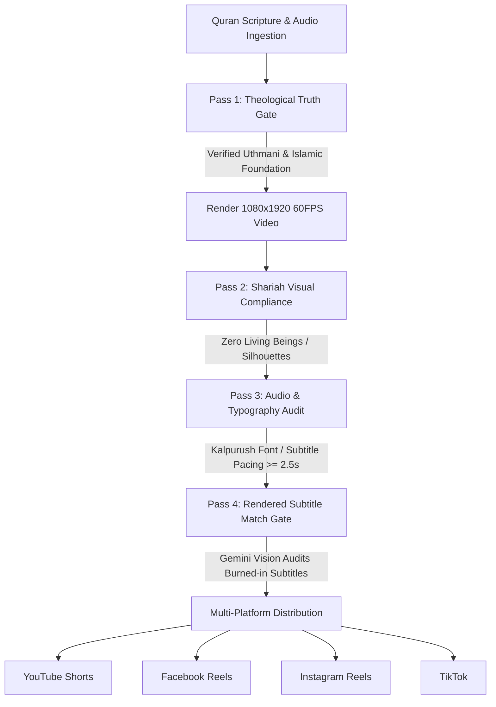

# 📖 DailyDos Islam — Automated Islamic Video Publishing Engine

[](https://github.com/0XpoeticX0/Auto_Upload/actions/workflows/daily_quran.yml)
[](https://github.com/0XpoeticX0/Auto_Upload/actions/workflows/daily_quran_mix_evening.yml)
[](LICENSE)
[](https://www.python.org/)
[](#1-visual-standards--halal-compliance)

An enterprise-grade, fully automated, 100% cloud-hosted video production and distribution pipeline for authentic Islamic content. Built for multi-platform broadcasting across **YouTube Shorts**, **Facebook Reels**, **Instagram Reels**, and **TikTok**.

---

## 🌟 Core Highlights

- **100% Cloud Autonomous**: Zero local dependencies. Runs daily via GitHub Actions workflows with persistent cross-run state sync.
- **Strict Shariah Visual Compliance**: Strictly 0 humans, 0 faces, 0 silhouettes, 0 statues, 0 animals. Pure atmospheric nature, celestial majesty, and sacred Islamic architecture.
- **Strict Ban on Static Photos**: 100% real high-definition live-motion footage (1080p/720p 60 FPS). Zero camera zooms or pans over still JPG/PNG images.
- **Approved Quran Reciters**: Sheikh Mishary Rashid Alafasy (comfort, mercy, repentance) and Sheikh Yasser Ad-Dossari (divine majesty, cosmic oaths, Day of Judgment).
- **Official Islamic Foundation Bangladesh Translation**: Authentic Bengali translations verified line-by-line against Uthmani Arabic script.
- **Broadcast Audio Standards**: Studio vocal mastering with EBU R128 two-pass loudness normalization at **-18.0 LUFS** (256 kbps).
- **Multi-Key Gemini Fallback Pool**: Automatically rotates through a 6-key API pool upon rate limits (HTTP 429) and locks the working key.

---

## 🛡️ 4-Pass Automated Verification Gate

Before any video is published, it must clear all four automated gates in [`app/quality/triple_gemini_verifier.py`](app/quality/triple_gemini_verifier.py). If any gate fails, the video is instantly deleted and the pipeline safely halts:



1. **Pass 1 — Religious & Contextual Truth**: Cross-references Arabic text with Uthmani script and Islamic Foundation Bangladesh Bengali translation. Prevents theological distortions.
2. **Pass 2 — Shariah Visual Audit**: Uses a local PyTorch MobileNet object detector plus Gemini Multimodal Vision API across sampled frames to enforce zero living beings.
3. **Pass 3 — Audio & Typography Verification**: Enforces `Kalpurush` font, center-locked subtitles (`\pos(540,960)`), maximum 1–2 lines, duration $\ge 2.5$s per card, and -18.0 LUFS loudness.
4. **Pass 4 — Post-Render Subtitle Match**: Extracts frames from the final rendered MP4 at Ayah timestamps and uses Gemini Vision to read on-screen Bengali subtitles, ensuring 100% match with the recited passage.

---

## 📅 Automated Publishing Schedules

All pipelines run fully in the cloud via GitHub Actions:

| Pipeline | Target BST (UTC) | Workflow File | Description |
| :--- | :--- | :--- | :--- |
| **Morning Quran Recitation** | **06:30 AM – 07:30 AM BST**<br>`cron: '0 22 * * *'` (22:00 UTC) | [`.github/workflows/daily_quran.yml`](.github/workflows/daily_quran.yml) | Pure Arabic recitation with synchronized Bengali subtitles (< 85s). |
| **Afternoon Quran Mix** | **03:07 PM BST**<br>`cron: '7 9 * * *'` (09:07 UTC) | [`.github/workflows/daily_quran_mix_evening.yml`](.github/workflows/daily_quran_mix_evening.yml) | Alternating Arabic recitation + spoken Bengali translation (Sheikh Mishary Alafasy & Zayed Iqbal). Includes nighttime delay guard. |
| **Islamic Quiz Reels** | **Friday 05:00 AM & Monday 09:00 AM BST** | [`.github/workflows/quiz_upload.yml`](.github/workflows/quiz_upload.yml) | Engaging Islamic multiple-choice quiz reels with sound effects and countdown timers. |

---

## 🔁 Selection Engine & Deduplication

1. **50/50 Dual Mode Rotation**:
   - **Mode A (Curated Masterpieces)**: Cycles through a curated bank of 50 multi-verse Quranic passages pre-audited between **23.2s and 74.8s** across 7 emotional pillars (Solace & Anxiety, Divine Majesty, Tawakkul & Rizq, Repentance & Hope, The Day of Reckoning, Character of Believers, Celestial Signs).
   - **Mode B (Random AI Discovery)**: Gemini dynamically discovers self-contained spiritual verses from the Quran.
2. **60-Video Lookback Window**:
   - Queries Supabase and local history (`data/history_log.json`).
   - Strictly blocks any Surah and Ayah range published in the last 60 videos to guarantee diverse content.
3. **Dynamic 3-Clip Triplet Selection**:
   - Selects 3 non-overlapping live-motion clips from 50 halal categories in `data/stock_video_catalog.json` (`Category(Clip 1) != Category(Clip 2) != Category(Clip 3)`).
   - Cycles round-robin in 15s–20s scenes without static anchors.

---

## 🗂️ Project Structure

```text
├── .github/workflows/             # GitHub Actions automation workflows
│   ├── daily_quran.yml            # Daily Morning Quran Recitation (06:00 AM BST)
│   ├── daily_quran_mix_evening.yml# Daily Afternoon Quran Mix (03:00 PM BST)
│   └── quiz_upload.yml            # 2x Weekly Islamic Quiz Reel pipeline
├── app/
│   ├── assets/
│   │   ├── broll/                 # High-definition fallback nature footage (ocean, clouds, desert)
│   │   ├── fonts/                 # Kalpurush, Amiri, and Noto font families
│   │   └── quran/                 # Official Islamic Foundation Bangladesh Quran JSON
│   ├── llm/
│   │   └── provider.py            # 6-Key Gemini dynamic fallback & active lock engine
│   ├── quality/
│   │   ├── triple_gemini_verifier.py # 4-Pass Gemini verification gatekeeper
│   │   ├── bengali_hook_guardian.py  # Bengali grammar & natural phrasing checker
│   │   └── vision_guardian.py        # Frame-by-frame Shariah visual auditor
│   ├── quran_verse/
│   │   ├── generator.py           # Core Quran video generator
│   │   ├── quran_data.py          # 50 Curated Masterpieces & EveryAyah endpoints
│   │   ├── mix_generator.py       # Arabic + Spoken Bangla Mix video generator
│   │   ├── mix_scheduler.py       # Mix runner with nighttime delay safety guard
│   │   ├── renderer.py            # FFmpeg 60FPS video & ASS subtitle compositor
│   │   ├── scheduler.py           # Morning Quran slot runner
│   │   └── triplet_rotator.py     # Halal clip triplet selector & CDN downloader
│   ├── upload/
│   │   ├── youtube.py             # YouTube Shorts API uploader with token auto-refresh
│   │   ├── facebook.py            # Facebook Graph API Reel uploader
│   │   ├── instagram.py           # Instagram Graph API containerized chunked uploader
│   │   └── tiktok.py              # TikTok Content Posting API driver
│   ├── config.py                  # Environment config loader
│   └── history.py                 # Supabase & local JSON anti-repetition registry
├── data/                          # Runtime persistent state files (auto-committed in CI)
│   ├── gemini_key_lock_state.json # Active working Gemini API key tracker
│   ├── quran_selection_state.json # 50/50 Curated vs. Random selection state
│   ├── video_rotation_state.json  # Halal stock footage rotation index
│   ├── stock_video_catalog.json   # 1000 certified halal live-motion clip catalog
│   └── history_log.json           # Published video history log
├── GEMINI.md                      # Production Standards & Quality Mandates
├── requirements.txt               # Python package dependencies
└── README.md                      # Documentation
```

---

## 🔑 GitHub Secrets Configuration

To run the cloud automation, configure the following secrets in your GitHub Repository under **Settings > Secrets and variables > Actions**:

### 1. Artificial Intelligence (Gemini API Pool)
- `GEMINI_API_KEY`: Primary Google Gemini API key.
- `GEMINI_BACKUP_API_KEY`: Secondary Gemini API key.
- `GEMINI_KEY_3`: Fallback Gemini API key 3.
- `GEMINI_KEY_4`: Fallback Gemini API key 4.
- `GEMINI_KEY_5`: Fallback Gemini API key 5.
- `GEMINI_POST_API_KEY`: Dedicated key for post metadata.

### 2. Social Media Distribution Platforms
- `YOUTUBE_TOKEN_JSON`: Full JSON content of OAuth `token.json` (auto-refreshed by Google API Client).
- `YOUTUBE_CLIENT_SECRETS_JSON`: Google Cloud OAuth `client_secrets.json`.
- `FB_ACCESS_TOKEN`: Long-lived Facebook Page Access Token (Page & Instagram Reel upload permissions).
- `FB_PAGE_ID`: Facebook Page ID.
- `IG_USER_ID`: Connected Instagram Professional Account ID.
- `TIKTOK_ACCESS_TOKEN` *(Optional)*: TikTok Open Platform Access Token.

### 3. Database & Deduplication
- `SUPABASE_URL`: Supabase project URL (`https://<project-ref>.supabase.co`).
- `SUPABASE_KEY`: Supabase service role or anon key.

---

## 📜 Shariah & Production Compliance Mandate

All content produced adheres strictly to the mandates defined in [`GEMINI.md`](GEMINI.md):
- **Zero Living Beings**: No humans, faces, silhouettes, animals, statues, or digital depictions of living creatures.
- **Scripture Authenticity**: Strictly uses EveryAyah recitation recordings without artificial voice distortion or destructive filtering.
- **Zero Watermarks**: Strictly watermark-free cinematic video footage.
- **Accurate Subtitles**: `Kalpurush` font, center-aligned (`\pos(540,960)`), max 1–2 lines, duration $\ge 2.5$s per subtitle card.

---

## 📄 License

This project is licensed under the MIT License — see the [LICENSE](LICENSE) file for details.
